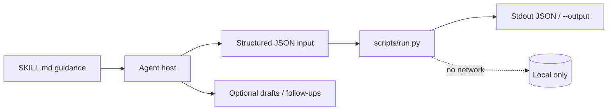
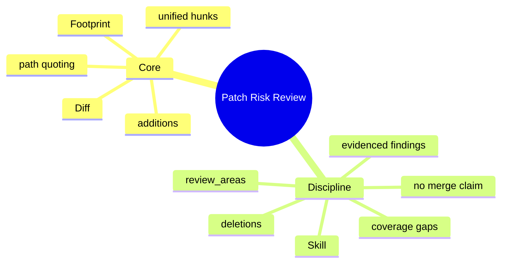

# Patch Risk Review

[English](README.md) · [中文](README.zh-CN.md) · **v0.2.1**

[](https://github.com/KarmenLoop/skill-patch-risk-review/actions/workflows/checks.yml)
[](https://github.com/KarmenLoop/skill-patch-risk-review/releases/latest)
[](https://www.python.org/downloads/)
[](LICENSE)
[](docs/COMPATIBILITY.md)

**Map a Git unified diff to per-file footprint and focused review areas—before you open the full change.**

An agent skill plus a local diff footprint helper: additions, deletions, and path-based review hints such as authentication. You keep the export (or transcript, diff, ledger, event log, or JUnit XML) local; the helper stays on the standard library and never opens a network connection. The skill layer teaches a host *when* to prepare input, *how* to narrate results, and *where* to stop before side effects the user did not authorize.

Built and maintained by [KarmenLoop](https://github.com/KarmenLoop) / [KARMENLOOP](https://karmenloop.com). Current release: **[v0.2.1](https://github.com/KarmenLoop/skill-patch-risk-review/releases/tag/v0.2.1)**. License: **MIT**.


*Actual local output from v0.2.1, rendered as an image. [examples/expected.json](examples/expected.json) · [Image provenance](docs/images/provenance.json).*

[Download v0.2.1](https://github.com/KarmenLoop/skill-patch-risk-review/releases/tag/v0.2.1) · [Tutorial](docs/tutorial.en.md) · [中文教程](docs/tutorial.zh-CN.md) · [Input contract](docs/INPUT.md)

---

## Why this exists

Large diffs bury the files that actually deserve attention. Agents that summarize a pull request often invent findings or miss auth surfaces.

This helper stays honest: it **parses** a complete Git-style unified diff, counts hunk lines, and attaches path-based `review_areas`. It does not claim vulnerabilities.

The skill layer then walks changed functions, traces authorization and error paths, and reports only evidenced behavior regressions—with coverage gaps stated when nothing solid is found.

---

## Snapshot

| | |
|---|---|
| **What you install** | Skill tree + `scripts/run.py` footprint helper + `install.py` |
| **Runtime** | Python **3.9+**, standard library only |
| **Network** | **None** — does not fetch or apply patches |
| **Input** | UTF-8 JSON: `{ "diff": "<unified diff>" }` (empty allowed; quoted/UTF-8 paths supported) |
| **Output** | `files[]` with additions/deletions/`review_areas`; `totals` across hunks |
| **Install hosts** | `codex` · `deepseek` · `grok` · `agents` |
| **Package id** | `karmen-patch-risk-review` |
| **License** | MIT |

---

## Is / Is not

| Is | Is not |
|---|---|
| Footprint + path-based review area hints | A security audit or CVE scanner |
| Strict unified-diff parsing (rejects bad hunks) | Guessing from truncated patches |
| Skill guidance for evidenced findings | Merge approval or CI green-light |
| Offline stdlib helper | Remote git fetch / patch apply / test runner |
| Inventory of binary headers when present | Binary content analysis |

---

## How it works

Two layers stay separate on purpose:

1. **Method layer (`SKILL.md`)** — when to invoke, how to prepare honest input, what to deliver, and which side effects stay forbidden without fresh user authorization.
2. **Deterministic helper (`scripts/run.py`)** — validates a UTF-8 JSON contract (max 10 MiB), computes the result locally, prints JSON to stdout (or a new `--output` file), and exits `2` on invalid input.





### Workflow

1. **Collect** the exact base/head or working-tree unified diff. Keep unrelated local edits out of scope.
2. **Run** the footprint helper; compare totals with `git diff --stat` when useful.
3. **Read** each flagged file and its callers. Trace authorization, data lifecycle, cancellation, and errors.
4. **Report** only evidenced regressions with location and a meaningful check. State remaining coverage gaps if you find nothing solid.

### What the sample proves

The sample touches `src/auth.py`, adds two lines, removes one, and marks `authentication` for review.

Exit `0` means processing finished—not that every business finding “passed.”

---

## Quickstart

Download `karmen-patch-risk-review-v0.2.1.zip` and its `.sha256` from the [v0.2.1 release](https://github.com/KarmenLoop/skill-patch-risk-review/releases/tag/v0.2.1), verify the hash, and extract. Requires Python 3.9+.

```sh
python3 scripts/run.py --version
python3 scripts/run.py --input examples/input.json
```

Expected version string: `karmen-patch-risk-review 0.2.1`.

Optional: install into a host that scans a skills directory (installer refuses an existing destination):

```sh
python3 install.py --host agents
# also: --host codex | deepseek | grok
# or:  --destination /exact/new/directory
```

You can run the helper with no AI host at all. Host discovery and invocation still vary—see [docs/tutorial.en.md](docs/tutorial.en.md) and [docs/COMPATIBILITY.md](docs/COMPATIBILITY.md).

Pipe mode and version probe:

```sh
python3 scripts/run.py --input - < examples/input.json
python3 scripts/run.py --version
```

---

## Use it with your own work

Read [docs/INPUT.md](docs/INPUT.md) before shaping a new payload.

- Preserve headers and hunk counts; truncated diffs are rejected.
- Exercise paths with spaces or Git quoting.
- Review areas are hints—run the project’s own tests afterward.
- This never proves a patch is safe to merge.

The helper needs no model account, API key, or network. An AI host has its own data and permission settings; this skill adds no authority to send, purchase, publish, or change access.

---

## Documentation map

| Doc | Use it when you need… |
|---|---|
| [Tutorial (EN)](docs/tutorial.en.md) · [中文](docs/tutorial.zh-CN.md) | Download, install, practice, upgrade, remove |
| [Input / output contract](docs/INPUT.md) · [中文](docs/input.zh-CN.md) | Field semantics and examples |
| [Compatibility](docs/COMPATIBILITY.md) | Host install paths and unverified boundaries |
| [Validation](docs/VALIDATION.md) | What was actually exercised |
| [Sources](docs/SOURCES.md) | Research notes behind the design |
| [Changelog](CHANGELOG.md) | Release history |
| [Contributing](CONTRIBUTING.md) · [Support](SUPPORT.md) · [Security](SECURITY.md) | Collaboration and reports |

---

## Validation (honest)

Observed baseline (see [docs/VALIDATION.md](docs/VALIDATION.md)): 2026-10-18 (UTC) · Python 3.9.6 · macOS arm64 (see docs/VALIDATION.md).

| Check | Result |
|---|---|
| `python3 scripts/run.py --input examples/input.json` | Exit 0; fixture aligned with live output |
| `python3 -m unittest discover -s tests -v` | Exit 0 on maintainer run |
| `skill-creator` quick validate | Metadata accepted |

**Not claimed:** authenticated conversations inside every supported host, live account connectors, or native Windows/Linux host UI coverage. Installation is tested in temporary directories; model interpretation remains a host responsibility. Confirm the exact `SKILL.md` is discovered before relying on invocation.

CI: [`.github/workflows/checks.yml`](https://github.com/KarmenLoop/skill-patch-risk-review/actions/workflows/checks.yml).

---

## FAQ

### What is Patch Risk Review, in one sentence?

An MIT skill and offline helper that maps a Git unified diff to per-file line counts and path-based review areas as a starting point for human or agent review.

### Can this prove a patch is safe to merge?

No. Use it to choose where to look, then review code, requirements, and real test results.

### Does it understand syntax or prove vulnerabilities?

No. Path heuristics are not a defect finding. Binary files are inventoried only when a diff header is present.

### Will it fetch or apply my patch?

No. Networkless. It only reads the JSON you supply.

### Where does output go?

Stdout or a new `--output` file; existing files preserved.

### Install?

`python3 install.py --host agents` (also `codex` / `deepseek` / `grok`).

---

## License and contact

[MIT](LICENSE) · Keep the license and [notice](NOTICE.md) with redistributed copies.

[karmenloop.com](https://karmenloop.com) · [GitHub @KarmenLoop](https://github.com/KarmenLoop) · [info@karmenloop.com](mailto:info@karmenloop.com)

KARMENLOOP Official Team · Shanghai

<!-- Copyright (C) 2026 KARMENLOOP Official Team
SPDX-License-Identifier: MIT -->
