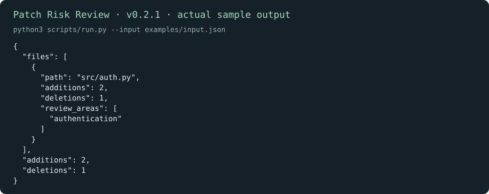
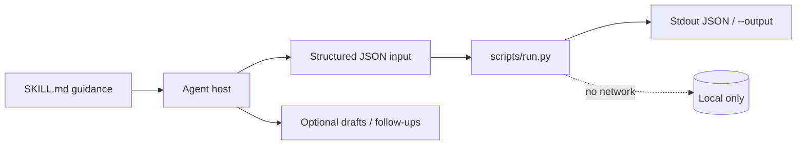
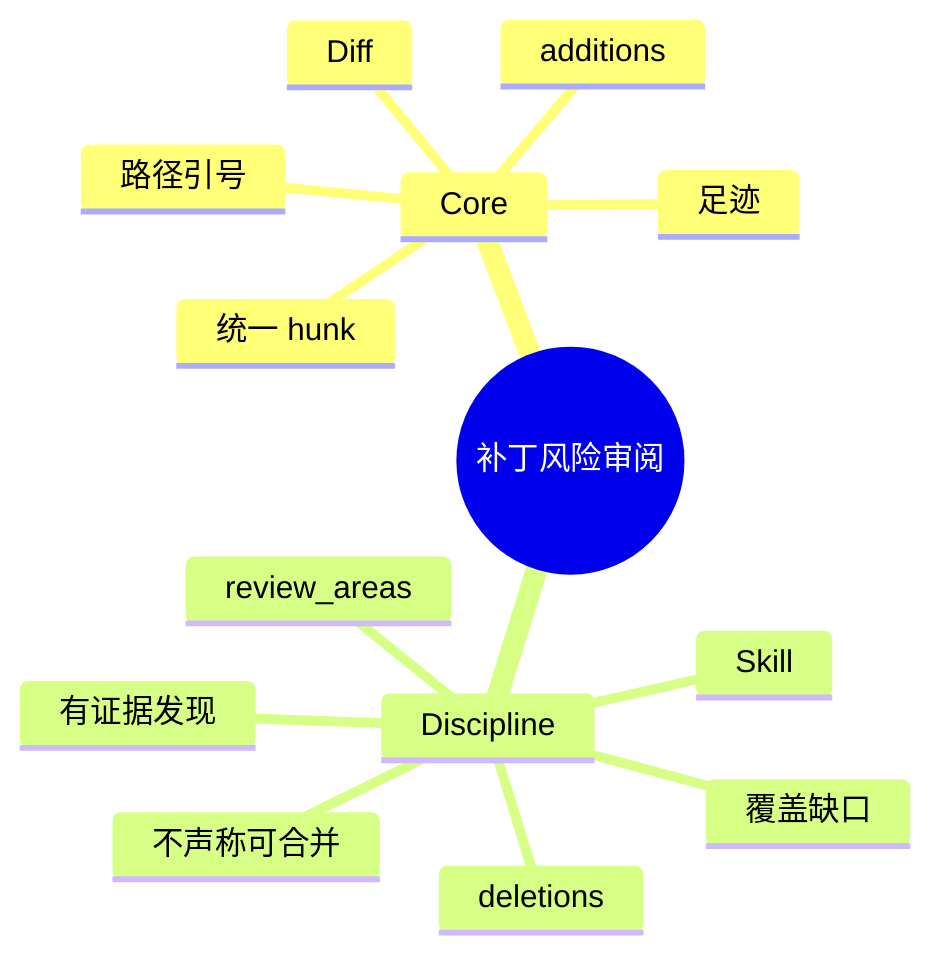

# 补丁风险审阅

[English](README.md) · [中文](README.zh-CN.md) · **v0.2.1**

[](https://github.com/KarmenLoop/skill-patch-risk-review/actions/workflows/checks.yml)
[](https://github.com/KarmenLoop/skill-patch-risk-review/releases/latest)
[](https://www.python.org/downloads/)
[](LICENSE)
[](docs/COMPATIBILITY.md)

**把 Git 统一 diff 映射成逐文件足迹与聚焦审阅区——再打开完整变更。**

一套 Agent Skill，外加本地 diff 足迹辅助程序：增减行统计，以及如 authentication 等基于路径的审阅提示。 导出（或会议文本、diff、账本、事件日志、JUnit XML）留在本地；辅助程序只用标准库，从不发起网络连接。Skill 层教宿主*何时*准备输入、*如何*陈述结果，以及在用户未授权的副作用前*停在哪里*。

由 [KarmenLoop](https://github.com/KarmenLoop) / [KARMENLOOP](https://karmenloop.com) 维护。当前发布：**[v0.2.1](https://github.com/KarmenLoop/skill-patch-risk-review/releases/tag/v0.2.1)**。许可证：**MIT**。



*v0.2.1 真实本地输出渲染图。[examples/expected.json](examples/expected.json) · [图像出处](docs/images/provenance.json)。*

[下载 v0.2.1](https://github.com/KarmenLoop/skill-patch-risk-review/releases/tag/v0.2.1) · [英文教程](docs/tutorial.en.md) · [中文教程](docs/tutorial.zh-CN.md) · [输入契约](docs/input.zh-CN.md)

---

## 为什么做这个

大 diff 会淹没真正值得看的文件。只会「总结 PR」的 Agent 往往编造发现，或漏掉鉴权面。

本辅助程序保持诚实：它**解析**完整的 Git 风格统一 diff，统计 hunk 行数，并附着基于路径的 `review_areas`。它不宣称漏洞。

Skill 层再阅读变更函数、追踪授权与错误路径，只报告有证据的行为回退——若无扎实发现，则写明覆盖缺口。

---

## 快照

| | |
|---|---|
| **安装内容** | Skill 树 + `scripts/run.py` 足迹辅助程序 + `install.py` |
| **运行时** | Python **3.9+**，仅标准库 |
| **网络** | **无** — 不拉取、不应用补丁 |
| **输入** | UTF-8 JSON：`{ "diff": "<统一 diff>" }`（允许空；支持引号/UTF-8 路径） |
| **输出** | `files[]` 含增减行与 `review_areas`；跨 hunk 的 `totals` |
| **安装宿主** | `codex` · `deepseek` · `grok` · `agents` |
| **包标识** | `karmen-patch-risk-review` |
| **许可证** | MIT |

---

## 是 / 不是

| 是 | 不是 |
|---|---|
| 足迹 + 基于路径的审阅区提示 | 安全审计或 CVE 扫描器 |
| 严格统一 diff 解析（拒绝坏 hunk） | 从截断补丁瞎猜 |
| Skill 指导有证据的发现 | 合并批准或 CI 放行 |
| 离线标准库辅助程序 | 远程 git fetch / 应用补丁 / 跑测试 |
| 出现时清点 binary 头 | 二进制内容分析 |

---

## 工作方式

两层有意分开：

1. **方法层（`SKILL.md`）** — 何时调用、如何准备诚实输入、交付什么，以及哪些副作用在没有新的用户授权时仍禁止。
2. **确定性辅助程序（`scripts/run.py`）** — 校验 UTF-8 JSON 契约（最大 10 MiB），本地计算，打印到 stdout（或新的 `--output`），非法输入以 `2` 退出。





### 流程

1. **收集**精确的 base/head 或工作区统一 diff。无关本地改动不要塞进范围。
2. **运行**足迹辅助程序；需要时与 `git diff --stat` 对照。
3. **阅读**每个被标出的文件及其调用方。追踪授权、数据生命周期、取消与错误路径。
4. **只报告**有证据的回退，附位置与有意义的检查。若无扎实发现，写明剩余覆盖缺口。

### 示例证明什么

示例触及 `src/auth.py`，新增两行、删除一行，并将 `authentication` 标为审阅区。

退出码 `0` 表示处理完成——不表示业务上「全部通过」。

---

## 快速开始

从 [v0.2.1 发布页](https://github.com/KarmenLoop/skill-patch-risk-review/releases/tag/v0.2.1) 下载 `karmen-patch-risk-review-v0.2.1.zip` 与对应 `.sha256`，校验哈希后解压。需要 Python 3.9+。

```sh
python3 scripts/run.py --version
python3 scripts/run.py --input examples/input.json
```

期望版本串：`karmen-patch-risk-review 0.2.1`。

可选：安装到会扫描 skills 目录的宿主（目标已存在则拒绝）：

```sh
python3 install.py --host agents
# 亦可：--host codex | deepseek | grok
# 或：  --destination /精确/新目录
```

完全可以不借助 AI 宿主直接跑辅助程序。宿主发现与调用方式仍因产品而异——见 [docs/tutorial.zh-CN.md](docs/tutorial.zh-CN.md) 与 [docs/COMPATIBILITY.md](docs/COMPATIBILITY.md)。

管道与版本探测：

```sh
python3 scripts/run.py --input - < examples/input.json
python3 scripts/run.py --version
```

---

## 用在你自己的工作上

准备新载荷前先读 [docs/input.zh-CN.md](docs/input.zh-CN.md)（或 [docs/INPUT.md](docs/INPUT.md)）。

- 保留文件头与 hunk 计数；截断 diff 会被拒绝。
- 练习含空格或 Git 引号的路径。
- 审阅区只是提示——之后仍要跑项目自身测试。
- 本工具从不证明补丁可以安全合并。

辅助程序不需要模型账号、API 密钥或网络。AI 宿主有自己的数据与权限设置；本 skill 不授予发送、购买、发布或改权限的权力。

---

## 文档地图

| 文档 | 何时使用 |
|---|---|
| [教程（中文）](docs/tutorial.zh-CN.md) · [English](docs/tutorial.en.md) | 下载、安装、练习、升级、卸载 |
| [输入/输出契约（中文）](docs/input.zh-CN.md) · [EN](docs/INPUT.md) | 字段语义与示例 |
| [兼容性](docs/COMPATIBILITY.md) | 宿主安装路径与未验证边界 |
| [验证](docs/VALIDATION.md) | 实际跑过什么 |
| [来源](docs/SOURCES.md) | 设计背后的研究笔记 |
| [变更日志](CHANGELOG.md) | 发布历史 |
| [贡献](CONTRIBUTING.md) · [支持](SUPPORT.md) · [安全](SECURITY.md) | 协作与报告 |

---

## 验证（如实）

基线见 [docs/VALIDATION.md](docs/VALIDATION.md)：2026-10-18 (UTC) · Python 3.9.6 · macOS arm64 (see docs/VALIDATION.md)。

| 检查 | 结果 |
|---|---|
| `python3 scripts/run.py --input examples/input.json` | 退出 0；夹具与实跑输出对齐 |
| `python3 -m unittest discover -s tests -v` | 维护者环境退出 0 |
| `skill-creator` 快速校验 | 元数据通过 |

**未声称：** 每个支持宿主内的已登录对话、在线账号连接器，或 Windows/Linux 宿主 UI 全覆盖。安装在临时目录测过；模型如何解释仍是宿主责任。依赖调用前请确认精确的 `SKILL.md` 已被发现。

CI：[`.github/workflows/checks.yml`](https://github.com/KarmenLoop/skill-patch-risk-review/actions/workflows/checks.yml)。

---

## 常见问题

### 一句话：补丁风险审阅是什么？

MIT Skill + 离线辅助程序：把 Git 统一 diff 映射为逐文件行数统计与基于路径的审阅区，作为人工或 Agent 审阅起点。

### 能证明补丁可安全合并吗？

不能。用它决定往哪看，再审代码、需求与真实测试结果。

### 懂语法或能证明漏洞吗？

不懂、不能。路径启发式不是缺陷结论。仅在出现 diff 头时清点二进制文件。

### 会拉取或应用补丁吗？

不会。无网络。只读你提交的 JSON。

### 输出到哪？

stdout 或新的 `--output`；已有文件保留。

### 如何安装？

`python3 install.py --host agents`（也支持 `codex` / `deepseek` / `grok`）。

---

## 许可与联系

[MIT](LICENSE)。再分发时请保留许可证与 [声明](NOTICE.md)。

[karmenloop.com](https://karmenloop.com) · [GitHub @KarmenLoop](https://github.com/KarmenLoop) · [info@karmenloop.com](mailto:info@karmenloop.com)

KARMENLOOP Official Team · 上海

<!-- Copyright (C) 2026 KARMENLOOP Official Team
SPDX-License-Identifier: MIT -->
